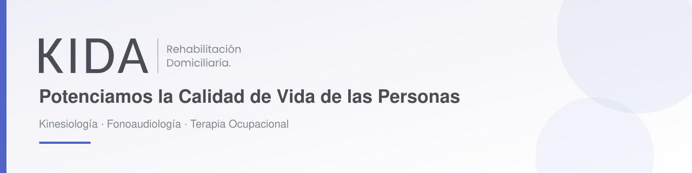

  

  
  
  

 

<table>
  <tr>
    <td width="55%" valign="middle">
      <h2>La rehabilitación, en tu casa</h2>
      

        Después de una internación, una cirugía o una lesión, <b>el mejor lugar para recuperarse es el hogar</b>.
        En KIDA llevamos kinesiólogos, fonoaudiólogos y terapistas ocupacionales hasta la puerta de cada paciente,
        con un plan único, personalizado y con metas reales.
      

      

        Acompañamos al paciente <b>y a su entorno</b>: porque la recuperación es un trabajo de todos.
      

    </td>
    <td width="45%" align="center">
      
    </td>
  </tr>
</table>

 

## Qué hacemos

<table>
  <tr>
    <td align="center" width="33%">
      <h3>Kinesiología</h3>
      Objetivos centrados en las necesidades individuales de cada paciente.
    </td>
    <td align="center" width="33%">
      <h3>Fonoaudiología</h3>
      Abordaje especializado, integrado al plan interdisciplinario.
    </td>
    <td align="center" width="33%">
      <h3>Terapia Ocupacional</h3>
      Herramientas para recuperar autonomía en las tareas del día a día.
    </td>
  </tr>
</table>

 

## Por qué elegir KIDA

<table>
  <tr>
    <td width="50%" valign="top">
      <h4>Rehabilitación post hospitalaria</h4>
      El regreso a casa es un momento clave. Buscamos un nuevo equilibrio entre el paciente y su entorno, con confort y motivación para recuperar las habilidades perdidas.
      <h4>Rehabilitación en el domicilio</h4>
      Profesionales formados específicamente para trabajar en contexto domiciliario. Cada plan arranca con una evaluación exhaustiva del caso.
    </td>
    <td width="50%" valign="top">
      <h4>Atención a pacientes particulares</h4>
      Cuidados y terapias especializadas para quienes se recuperan de lesiones, cirugías o enfermedades crónicas, en el hogar o en centros de rehabilitación.
      <h4>Equipo en formación continua</h4>
      Capacitación permanente coordinada por KIDA Argentina, más calidez humana, empatía y manejo de crisis en cada visita.
    </td>
  </tr>
</table>

 

## Cómo es trabajar con nosotros

| 1. Consulta | 2. Evaluación | 3. Plan personalizado | 4. Seguimiento |
|:---:|:---:|:---:|:---:|
| Nos escribís o llamás y coordinamos la primera visita. | Un profesional evalúa el caso en el domicilio. | Definimos metas reales y el trabajo a realizar. | Sesión a sesión, con contención para el paciente y su familia. |

 

## Lo que dicen nuestros pacientes

> ⭐⭐⭐⭐⭐ *"Excelente atención, super recomendable el servicio domiciliario, siempre llegan puntuales y la recuperación se nota sesión a sesión. Los chicos de Kida son un 10!!"*
> **María Paz Vidueiro**

> ⭐⭐⭐⭐⭐ *"Excelente atención, profesionales de alto nivel. Trabajan con total empatía y compromiso con el paciente. Fueron de gran ayuda para mi recuperación."*
> **Claudia Orozco**

> ⭐⭐⭐⭐⭐ *"Atendieron a mi papá hace un tiempo. Profesionalismo y calidez en el trato del paciente. Empatía y flexibilidad para coordinar visitas."*
> **Florencia Russo**

 

## KIDA para empresas

Trabajamos junto a **obras sociales, prepagas e instituciones de salud** de forma cercana, adaptando procesos y metodologías a cada estructura. Porque un buen resultado nace de una planificación en la que todas las partes suman.

  

 

## Sumate al equipo

¿Sos profesional de la salud y compartís nuestra forma de trabajar? Escribinos a **[info@kida.com.ar](mailto:info@kida.com.ar)** con tu CV.

---

  <a href="https://wa.me/5491154836096">WhatsApp 11 5483 6096</a> ·
  <a href="https://www.instagram.com/kida.arg/">Instagram</a> ·
  <a href="https://www.facebook.com/kida.arg">Facebook</a> ·
  <a href="https://kida.com.ar/">kida.com.ar</a>
   
  © KIDA Argentina · Potenciamos la calidad de vida de las personas

